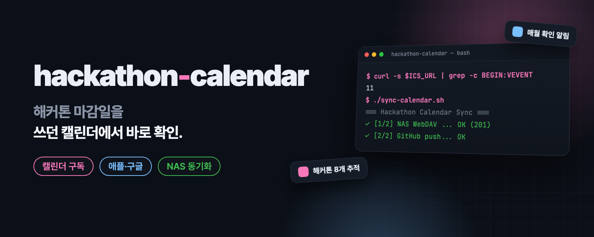
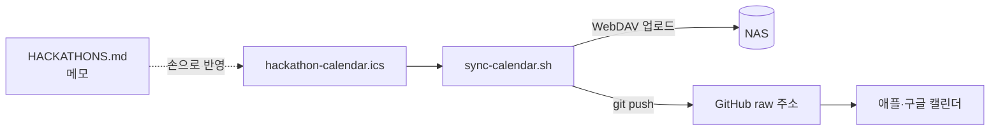

<p align="center">
  
</p>

<p align="center">
  <a href="README.md"><b>English</b></a> · <b>한국어</b>
</p>

<h2 align="center">해커톤 마감일을, 쓰던 캘린더에서 바로 확인하세요.</h2>

<p align="center">
  애플 캘린더·구글 캘린더 등 iCalendar 앱에 주소 하나로 구독합니다.<br>
  작은 셸 스크립트가 NAS(WebDAV)와 GitHub에 최신 파일을 올립니다.
</p>

<p align="center">
  <a href="LICENSE"></a>
  <a href="https://github.com/kks0488/hackathon-calendar/stargazers"></a>
  
  <a href="https://github.com/kks0488/hackathon-calendar/commits/main"></a>
</p>

<table>
<tr>
<td width="50%" valign="top">

### 한 번만 구독
캘린더는 GitHub에서 제공하는 평범한 `.ics` 파일입니다. 주소를 한 번 추가하면 캘린더 앱이 알아서 갱신합니다.

</td>
<td width="50%" valign="top">

### 알림이 붙은 마감일
해커톤마다 상금·형식·링크가 메모에 담긴 일정이 있고, 중요한 마감은 알림이 달린 별도 리마인더 일정으로 챙깁니다.

</td>
</tr>
<tr>
<td width="50%" valign="top">

### 매월 확인 알림
매월 1일 반복 일정이 새 해커톤을 확인할 플랫폼(Devpost, LabLab.ai, MLH, 콘테스트코리아)을 알려 줍니다.

</td>
<td width="50%" valign="top">

### 선택: NAS 동기화
`sync-calendar.sh`가 파일을 WebDAV로 NAS에 올리고 GitHub에 커밋합니다. 자격증명은 본인만 읽을 수 있는 별도 파일에 둡니다.

</td>
</tr>
</table>

## 구독하기

```text
https://raw.githubusercontent.com/kks0488/hackathon-calendar/main/hackathon-calendar.ics
```

**애플 캘린더(아이폰):** 설정 › 캘린더 › 계정 › 계정 추가 › 기타 › 구독 캘린더 추가에 주소를 붙여 넣습니다(iOS 버전마다 경로가 조금 다릅니다). 맥에서는 파일 › 새로운 캘린더 구독.

**구글 캘린더:** calendar.google.com에서 *다른 캘린더* 옆 **+** › **URL로 추가**에 주소를 붙여 넣습니다.

## 데모

<p align="center">
  
</p>

<sub>두 <code>curl</code> 명령은 공개 피드에 실제로 실행한 결과입니다. 동기화 출력은 두 단계가 모두 성공했을 때 스크립트가 찍는 내용입니다.</sub>

## 캘린더에 든 것

목록은 **2026-02-27**에 마지막으로 갱신했고, 아래 해커톤은 모두 끝났습니다. 매월 확인 알림은 2026년 12월까지 반복됩니다.

| 해커톤 | 기간 (2026) | 상금 |
|---|---|---|
| Vercel Global AI Gateway Hackathon | 9월 5일까지 | AI 크레딧 $2,500 / $1,000 / $500 |
| Microsoft AI Dev Days Hackathon | 2월 10일 – 3월 15일 | $10,000 + Microsoft Build 티켓 |
| LabLab.ai AI Trading Agents (ERC-8004) | 3월 9일 – 22일 | $50,000 |
| MLH Global Hack Week: Cloud | 3월 13일 – 19일 | 무료 행사 |
| MLH Global Hack Week: APIs | 4월 10일 – 16일 | 무료 행사 |
| Anthropic x USC Claude Hackathon | 5월 4일 마감 | Claude API 크레딧 |
| MLH Global Hack Week: GenAI | 5월 8일 – 14일 | 무료 행사 |
| DevNetwork [AI + ML] Hackathon | 5월 11일 – 28일 | 공개 안 됨 |

리마인더 3개도 있습니다. Microsoft AI Dev Days 마감 D-5와 마감 당일 알림, 그리고 매월 1일 확인 알림입니다.
일정별 메모, 출전 후보 프로젝트, 확인 루틴은 [HACKATHONS.md](HACKATHONS.md)에 있습니다.

## 내 캘린더로 쓰기

1. 저장소를 포크하고 `hackathon-calendar.ics`를 고칩니다(일정 하나당 `VEVENT` 하나).
2. 위와 같은 방법으로 내 포크의 raw 주소를 구독합니다.
3. 선택: NAS 동기화

```bash
cp .env.example .env          # NAS_WEBDAV_URL 설정
mkdir -p ~/.config/synology
printf 'NAS_WEBDAV_USER=...\nNAS_WEBDAV_PASSWORD=...\n' > ~/.config/synology/credentials.env
chmod 600 ~/.config/synology/credentials.env
./sync-calendar.sh
```

<details>
<summary><b>기술 세부 사항</b></summary>

- `sync-calendar.sh`는 저장소 폴더의 `.env`(Git 제외)를 읽고, 이어서 자격증명 파일(기본값 `~/.config/synology/credentials.env`, 또는 `SYNOLOGY_CREDENTIAL_FILE`)을 읽습니다.
- 자격증명 파일이 없거나, 심링크이거나, 현재 사용자 소유가 아니거나, 그룹·다른 사용자가 읽을 수 있으면 실행을 거부합니다.
- 1단계는 `curl -T`로 `.ics`를 올리고 HTTP 상태를 보여 줍니다(201·204면 성공). 2단계는 폴더가 git 저장소면 파일을 커밋하고 푸시합니다.
- NAS 관리자 계정이 아니라 캘린더 폴더에만 접근할 수 있는 별도 WebDAV 계정을 쓰세요.
- `bash`, `curl`, `git`, GNU `stat`(리눅스)이 필요합니다. macOS에는 `stat -c`가 없습니다.
- 캘린더 시간대는 `Asia/Seoul`입니다. 종일 일정은 `VALUE=DATE`, 매월 알림은 `RRULE:FREQ=MONTHLY;BYMONTHDAY=1;COUNT=10`을 씁니다.

</details>

## 동작 방식



## 자주 묻는 질문

**목록이 계속 갱신되나요?**
지금은 아닙니다. 2026-02-27에 마지막으로 갱신했고 그 일정은 끝났습니다. 내 목록을 만드는 틀로는 그대로 쓸 수 있습니다.

**NAS가 꼭 있어야 하나요?**
아니요. 구독은 GitHub raw 주소만으로 됩니다. NAS 업로드는 선택입니다.

**캘린더는 얼마나 자주 새로고침되나요?**
앱마다 다릅니다. 애플 캘린더는 주기를 고를 수 있고, 구글 캘린더는 자체 주기로 구독 캘린더를 갱신합니다.

## 계획 (아직 만들지 않음)

- `HACKATHONS.md`와 `.ics`를 따로 고치지 않도록 `.ics`를 자동 생성.
- 지금 열려 있는 해커톤으로 목록 갱신.

## 라이선스

[MIT](LICENSE)
