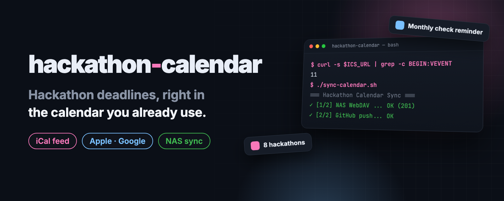

<p align="center">
  
</p>

<p align="center">
  <b>English</b> · <a href="README.ko.md"><b>한국어</b></a>
</p>

<h2 align="center">Hackathon deadlines, right in the calendar you already use.</h2>

<p align="center">
  One subscription URL for Apple Calendar, Google Calendar or any iCalendar app.<br>
  GitHub Actions refreshes the list every day. NAS sync over WebDAV is optional.
</p>

<p align="center">
  <a href="LICENSE"></a>
  <a href="https://github.com/kks0488/hackathon-calendar/stargazers"></a>
  
  <a href="https://github.com/kks0488/hackathon-calendar/commits/main"></a>
</p>

<table>
<tr>
<td width="50%" valign="top">

### Subscribe once
The calendar is a plain `.ics` file served from GitHub. Add its URL once and your calendar app keeps it in sync.

</td>
<td width="50%" valign="top">

### Deadlines with alarms
Each hackathon has a deadline event with prize, organizer, themes and link in its notes, plus alarms 3 days and 1 day before.

</td>
</tr>
<tr>
<td width="50%" valign="top">

### A daily refresh
GitHub Actions collects open and upcoming online hackathons from Devpost and MLH every day. LabLab.ai is included when its public listing provides parseable event data.

</td>
<td width="50%" valign="top">

### Optional NAS sync
`sync-calendar.sh` uploads the file to a NAS over WebDAV and commits it to GitHub. Credentials live in a separate file that must be private to you.

</td>
</tr>
</table>

## Subscribe

```text
https://raw.githubusercontent.com/kks0488/hackathon-calendar/main/hackathon-calendar.ics
```

**Apple Calendar (iPhone):** Settings › Calendar › Accounts › Add Account › Other › Add Subscribed Calendar, then paste the URL (the path differs slightly between iOS versions). On a Mac: File › New Calendar Subscription.

**Google Calendar:** on calendar.google.com, next to *Other calendars* click **+** › **From URL**, then paste the URL.

## Demo

<p align="center">
  
</p>

<sub>Historical example from the original feed; event counts and dates have changed. The optional sync output shows a successful NAS/GitHub run.</sub>

## What's in the calendar

Open and upcoming hackathons that accept online participation, with deadlines today or later (UTC). The current deadline-sorted list, update time and candidate projects are in [HACKATHONS.md](HACKATHONS.md) (Korean); normalized data is in [data/hackathons.json](data/hackathons.json).

Devpost dates without a published time appear as all-day deadlines. MLH uses the event end time. Check each event's link for eligibility and its exact submission cutoff.

## Run your own

1. Fork the repo and enable GitHub Actions. The update workflow runs daily at **21:17 UTC (06:17 KST the next day)**, or manually via **Actions → Update hackathon calendar → Run workflow**. No API keys or configured secrets are needed.
2. Subscribe to your fork's raw URL as above.
3. Optional NAS sync:

```bash
cp .env.example .env          # set NAS_WEBDAV_URL
mkdir -p ~/.config/synology
printf 'NAS_WEBDAV_USER=...\nNAS_WEBDAV_PASSWORD=...\n' > ~/.config/synology/credentials.env
chmod 600 ~/.config/synology/credentials.env
./sync-calendar.sh
```

To refresh locally with Python 3.11+ (standard library only):

```bash
python3 scripts/fetch_hackathons.py
python3 scripts/build_calendar.py
python3 -B -m unittest discover -s tests -v
```

<details>
<summary><b>Technical details</b></summary>

- `sync-calendar.sh` reads `.env` from the repository folder (git-ignored), then the credential file (default `~/.config/synology/credentials.env`, or `SYNOLOGY_CREDENTIAL_FILE`).
- It refuses to run if the credential file is missing, is a symlink, is not owned by the current user, or is readable by group or others.
- Step 1 uploads the `.ics` with `curl -T` and reports the HTTP status (201 or 204 means success). Step 2 commits and pushes the file if the folder is a git repository.
- Use a WebDAV account that can only reach the calendar folder, not a NAS admin account.
- Needs `bash`, `curl`, `git` and GNU `stat` (Linux). On macOS, `stat -c` is not available.
- The fetcher paginates Devpost's public JSON and reads the 2027 and 2026 MLH season pages. LabLab.ai is optional. Source failures and unparseable listings produce warnings while other sources continue.
- The builder generates `hackathon-calendar.ics`, `HACKATHONS.md` and `data/hackathons.json`, preserving the candidate project section. The workflow commits and pushes these files only when they change.
- Timed deadlines use UTC in the feed and KST in the tracker. Date-only listings use `VALUE=DATE`. Each event has a stable UID and two deadline alarms; the calendar name remains `Hackathon Tracker`.

</details>

## How it works

```mermaid
flowchart LR
  A[GitHub Actions<br>daily or manual] --> B[Public hackathon sources]
  B --> C[data/hackathons.json]
  C --> D[hackathon-calendar.ics<br>HACKATHONS.md]
  D -->|commit changed files| E[GitHub raw URL]
  E --> F[Apple / Google Calendar]
  D -. optional sync-calendar.sh .-> G[(NAS / WebDAV)]
```

## FAQ

**Is the list kept up to date?**
Yes. GitHub Actions is scheduled daily at 21:17 UTC and can also be run manually. See the last update time in [HACKATHONS.md](HACKATHONS.md) and source warnings in the workflow log.

**Do I need a NAS?**
No. The GitHub raw URL is enough to subscribe. The NAS upload is optional.

**How often does my calendar refresh?**
That depends on the app. Apple Calendar lets you choose an interval; Google Calendar refreshes subscribed calendars on its own schedule.

## License

[MIT](LICENSE)
