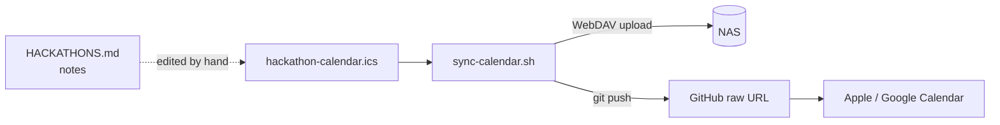

<p align="center">
  
</p>

<p align="center">
  <b>English</b> · <a href="README.ko.md"><b>한국어</b></a>
</p>

<h2 align="center">Hackathon deadlines, right in the calendar you already use.</h2>

<p align="center">
  One subscription URL for Apple Calendar, Google Calendar or any iCalendar app.<br>
  A small shell script pushes updates to a NAS over WebDAV and to GitHub.
</p>

<p align="center">
  <a href="LICENSE"></a>
  <a href="https://github.com/kks0488/hackathon-calendar/stargazers"></a>
  
  <a href="https://github.com/kks0488/hackathon-calendar/commits/main"></a>
</p>

<table>
<tr>
<td width="50%" valign="top">

### Subscribe once
The calendar is a plain `.ics` file served from GitHub. Add its URL once and your calendar app keeps it in sync.

</td>
<td width="50%" valign="top">

### Deadlines with alarms
Each hackathon is an event with prize, format and link in its notes. Separate reminder events with alarms flag key deadlines.

</td>
</tr>
<tr>
<td width="50%" valign="top">

### A monthly nudge
A recurring event on the 1st of each month lists the platforms to check for new hackathons (Devpost, LabLab.ai, MLH, Contest Korea).

</td>
<td width="50%" valign="top">

### Optional NAS sync
`sync-calendar.sh` uploads the file to a NAS over WebDAV and commits it to GitHub. Credentials live in a separate file that must be private to you.

</td>
</tr>
</table>

## Subscribe

```text
https://raw.githubusercontent.com/kks0488/hackathon-calendar/main/hackathon-calendar.ics
```

**Apple Calendar (iPhone):** Settings › Calendar › Accounts › Add Account › Other › Add Subscribed Calendar, then paste the URL (the path differs slightly between iOS versions). On a Mac: File › New Calendar Subscription.

**Google Calendar:** on calendar.google.com, next to *Other calendars* click **+** › **From URL**, then paste the URL.

## Demo

<p align="center">
  
</p>

<sub>The two <code>curl</code> commands are a real run against the published feed. The sync output is what the script prints when both steps succeed.</sub>

## What's in the calendar

The list was last updated on **2026-02-27**, and all of the hackathons below have since ended. The monthly check reminder repeats through December 2026.

| Hackathon | Dates (2026) | Prize |
|---|---|---|
| Vercel Global AI Gateway Hackathon | until Sep 5 | $2,500 / $1,000 / $500 AI credits |
| Microsoft AI Dev Days Hackathon | Feb 10 – Mar 15 | $10,000 + Microsoft Build tickets |
| LabLab.ai AI Trading Agents (ERC-8004) | Mar 9 – 22 | $50,000 |
| MLH Global Hack Week: Cloud | Mar 13 – 19 | Free event |
| MLH Global Hack Week: APIs | Apr 10 – 16 | Free event |
| Anthropic x USC Claude Hackathon | deadline May 4 | Claude API credits |
| MLH Global Hack Week: GenAI | May 8 – 14 | Free event |
| DevNetwork [AI + ML] Hackathon | May 11 – 28 | not listed |

Plus three reminders: a D-5 and a deadline-day alarm for Microsoft AI Dev Days, and the monthly check on the 1st.
Notes on each event, candidate projects and the checking routine are in [HACKATHONS.md](HACKATHONS.md) (Korean).

## Run your own

1. Fork the repo and edit `hackathon-calendar.ics` (one `VEVENT` per event).
2. Subscribe to your fork's raw URL as above.
3. Optional NAS sync:

```bash
cp .env.example .env          # set NAS_WEBDAV_URL
mkdir -p ~/.config/synology
printf 'NAS_WEBDAV_USER=...\nNAS_WEBDAV_PASSWORD=...\n' > ~/.config/synology/credentials.env
chmod 600 ~/.config/synology/credentials.env
./sync-calendar.sh
```

<details>
<summary><b>Technical details</b></summary>

- `sync-calendar.sh` reads `.env` from the repository folder (git-ignored), then the credential file (default `~/.config/synology/credentials.env`, or `SYNOLOGY_CREDENTIAL_FILE`).
- It refuses to run if the credential file is missing, is a symlink, is not owned by the current user, or is readable by group or others.
- Step 1 uploads the `.ics` with `curl -T` and reports the HTTP status (201 or 204 means success). Step 2 commits and pushes the file if the folder is a git repository.
- Use a WebDAV account that can only reach the calendar folder, not a NAS admin account.
- Needs `bash`, `curl`, `git` and GNU `stat` (Linux). On macOS, `stat -c` is not available.
- The calendar uses `Asia/Seoul` as its time zone. All-day events use `VALUE=DATE`; the monthly reminder uses `RRULE:FREQ=MONTHLY;BYMONTHDAY=1;COUNT=10`.

</details>

## How it works



## FAQ

**Is the list kept up to date?**
Not right now. It was last updated on 2026-02-27, and those events are over. The repository still works as a template for your own list.

**Do I need a NAS?**
No. The GitHub raw URL is enough to subscribe. The NAS upload is optional.

**How often does my calendar refresh?**
That depends on the app. Apple Calendar lets you choose an interval; Google Calendar refreshes subscribed calendars on its own schedule.

## Roadmap (planned, not built)

- Generate the `.ics` from `HACKATHONS.md` instead of editing both by hand.
- Refresh the list with currently open hackathons.

## License

[MIT](LICENSE)
